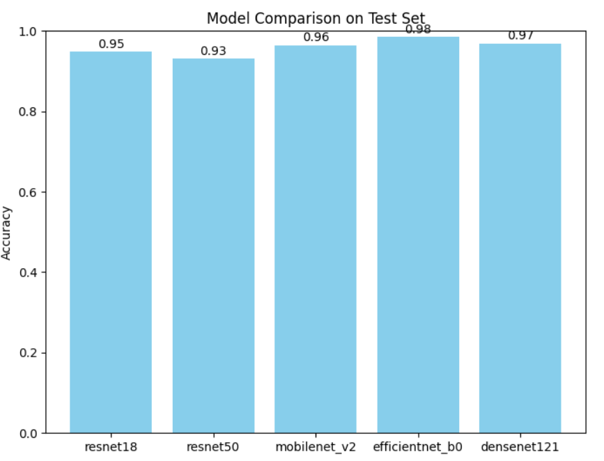
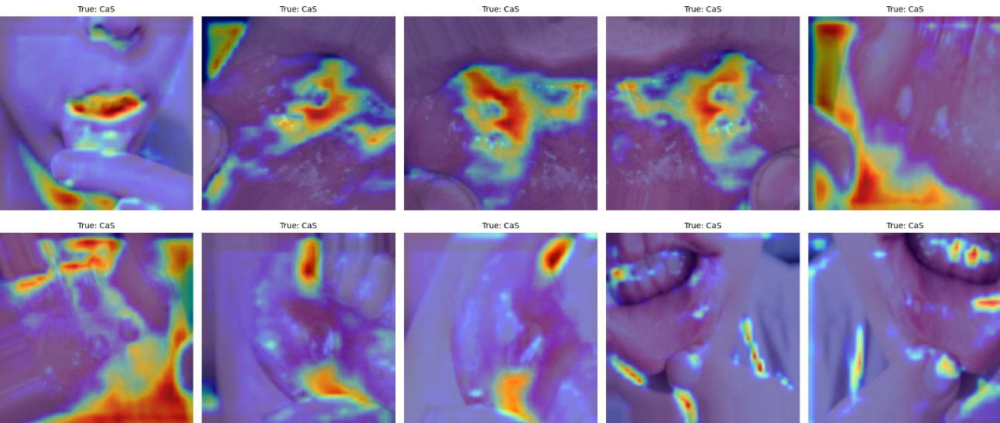

# Teeth Condition Classification

An end-to-end deep-learning project developed during the Cellula internship to
classify dental conditions from teeth images. The project uses PyTorch-based
convolutional neural networks, compares several pretrained architectures, and
includes a Streamlit application for interactive inference.

## Highlights

- Seven-class teeth-condition classification pipeline
- Training and evaluation workflow in a reproducible Jupyter notebook
- Comparison of ResNet, MobileNetV2, EfficientNet-B0, and DenseNet121
- Streamlit demo for uploading an image and viewing a prediction
- Grad-CAM visualizations for interpreting model attention

## Repository contents

| Path | Description |
| --- | --- |
| `notebooks/Teeth_Classification_Notebook.ipynb` | Training, evaluation, model comparison, and visualization workflow |
| `notebooks/streamlit_app.py` | Upload-and-predict Streamlit demo |
| `models/` | Selected checkpoints, predictions, targets, and training history |
| `reports/Teeth_Classification_Report.pdf` | Saved evaluation report |
| `assets/` | Figures used in this README |

## Results and visualizations

The model comparison on the test set shows EfficientNet-B0 achieving the best
accuracy among the evaluated architectures:

| Model | Test accuracy |
| --- | ---: |
| ResNet18 | 0.95 |
| ResNet50 | 0.93 |
| MobileNetV2 | 0.96 |
| EfficientNet-B0 | **0.98** |
| DenseNet121 | 0.97 |



*Test-set accuracy comparison across the evaluated architectures.*

Grad-CAM examples provide a visual indication of the image regions that
influenced the classifier’s predictions. These visualizations are intended for
interpretability and should not be treated as clinical evidence.



*Grad-CAM examples for test images predicted as the CaS class.*

Raw teeth images are not republished from the training dataset. The figures
above contain derived evaluation visualizations only.

## Dataset

The original `Teeth_Dataset` was provided privately during the internship and
is intentionally not included in this public repository. There is no public
download link documented here. If you are authorized to reproduce the
experiments, obtain the data from the internship instructor or the original
private course materials and place it at:

```text
data/Teeth_Dataset/
```

The notebook expects the `Training`, `Validation`, and `Testing` folders below
that directory.

## Getting started

### Run the notebook

Install the notebook dependencies, then open and run the notebook from the
repository root:

```bash
pip install torch torchvision scikit-learn matplotlib seaborn tqdm pillow jupyter
jupyter notebook notebooks/Teeth_Classification_Notebook.ipynb
```

### Run the demo

```bash
pip install streamlit torch torchvision pillow
streamlit run notebooks/streamlit_app.py
```

The demo loads the trained `models/efficientnet_b0_best.pth` checkpoint.
